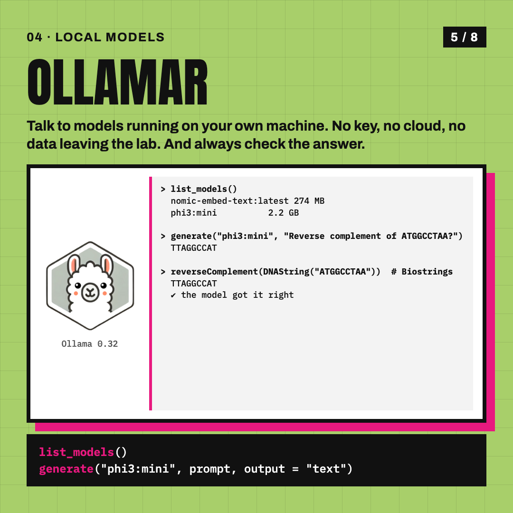

# AI in R, no Python

The code behind the Ibex Instagram carousel **"AI in R, no Python"**: six packages to chat, label, search and test with language models from the R console.
Every output on the slides is real and was captured from a 3.8B model (phi3:mini) running locally through Ollama. No API key, no data leaving the machine.

<p align="center">
  
  
  
  
</p>

| # | Package | What the slide shows | Script | Output |
|---|---|---|---|---|
| 01 | [ellmer](https://ellmer.tidyverse.org) | a chat answer and a structured (typed) answer | [`R/01_ellmer.R`](R/01_ellmer.R) | [`outputs/ellmer.txt`](outputs/ellmer.txt) |
| 02 | [mall](https://mlverse.github.io/mall/) | `llm_classify()` over five yeast gene descriptions | [`R/02_mall.R`](R/02_mall.R) | [`outputs/mall.txt`](outputs/mall.txt) |
| 03 | [ragnar](https://ragnar.tidyverse.org) | chunk, embed and retrieve from this repo's README | [`R/03_ragnar.R`](R/03_ragnar.R) | [`outputs/ragnar.txt`](outputs/ragnar.txt) |
| 04 | [ollamar](https://hauselin.github.io/ollama-r/) | list local models, ask for a reverse complement, verify with Biostrings | [`R/04_ollamar.R`](R/04_ollamar.R) | [`outputs/ollamar.txt`](outputs/ollamar.txt) |
| 05 | [btw](https://posit-dev.github.io/btw/) | describe a data frame and the session for an LLM | [`R/05_btw.R`](R/05_btw.R) | [`outputs/btw.txt`](outputs/btw.txt) |
| 06 | [vitals](https://vitals.tidyverse.org) | evaluate the model on four bioinformatics questions | [`R/06_vitals.R`](R/06_vitals.R) | [`outputs/vitals.txt`](outputs/vitals.txt) |

## Run it

```r
install.packages(c("ellmer", "mall", "ragnar", "ollamar", "btw", "vitals"))
```

```bash
brew install ollama && ollama serve &
ollama pull phi3:mini && ollama pull nomic-embed-text
for f in R/0*.R; do Rscript "$f"; done        # writes outputs/*.txt
```

Prefer a cloud model? Swap `chat_ollama(model = "phi3:mini")` for `chat_anthropic()` or `chat_openai()` in the ellmer and vitals scripts,
`llm_use("ollama", ...)` for `llm_use(chat_anthropic())` in the mall script, and `embed_ollama` for `embed_openai` in the ragnar script.

LLM answers vary between runs. On the first run the model got the reverse complement wrong, on the second it got it right: the Biostrings check in `R/04_ollamar.R` is the point.

The hex logos in [`logos/`](logos) belong to their package authors (the `mall` hex is a placeholder: the package has no logo yet).
