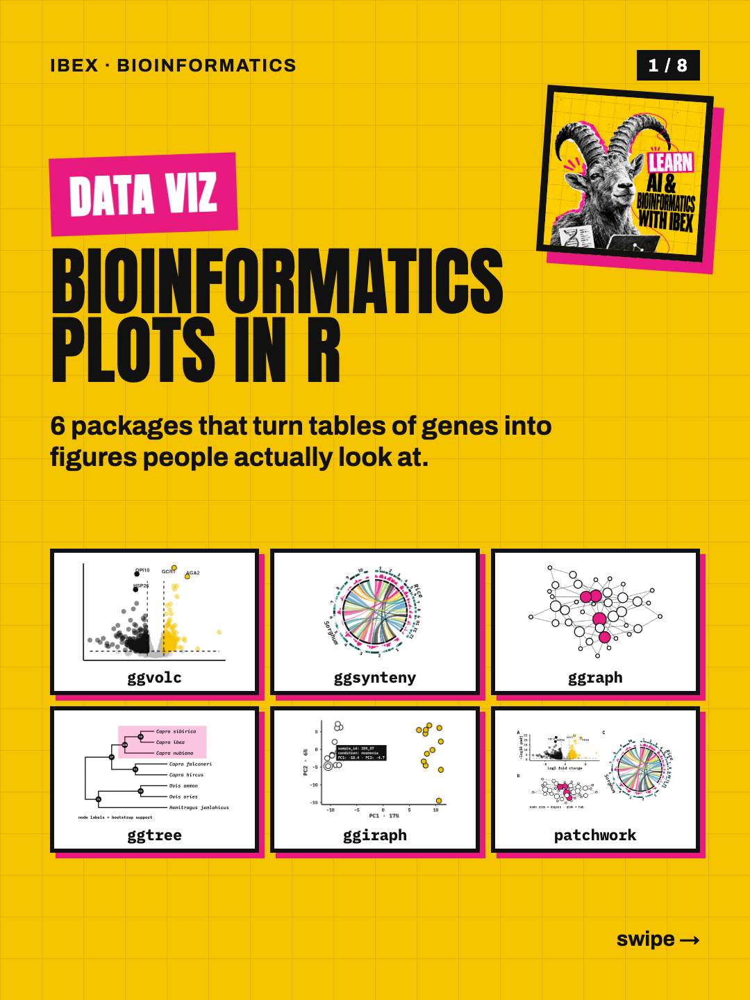
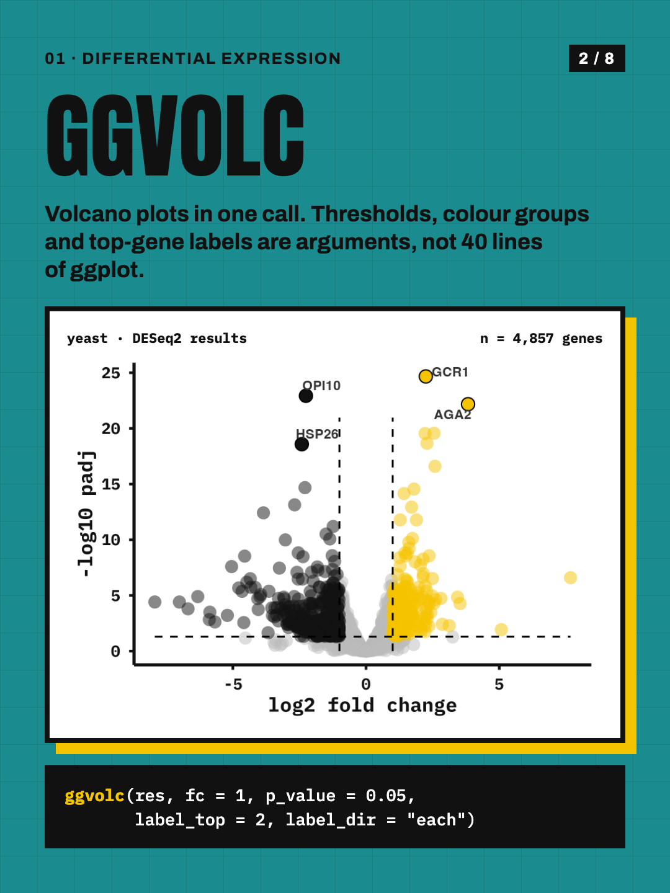
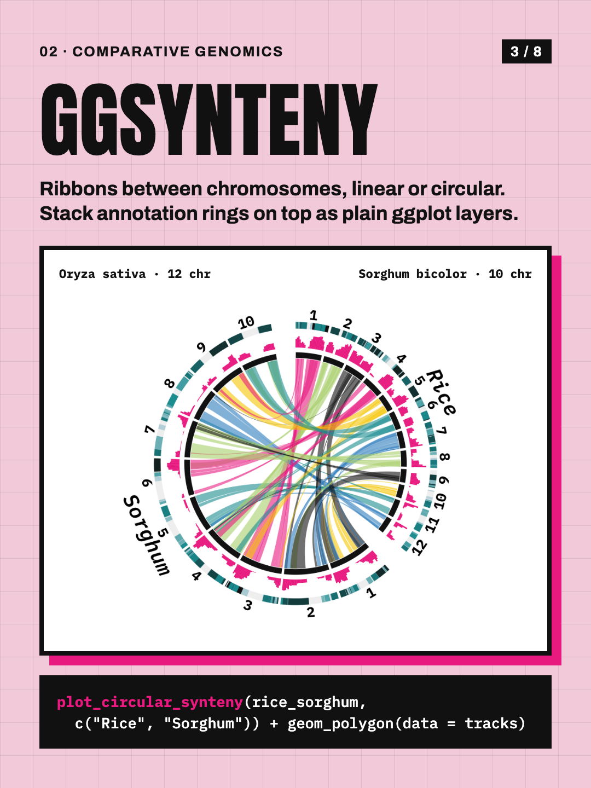
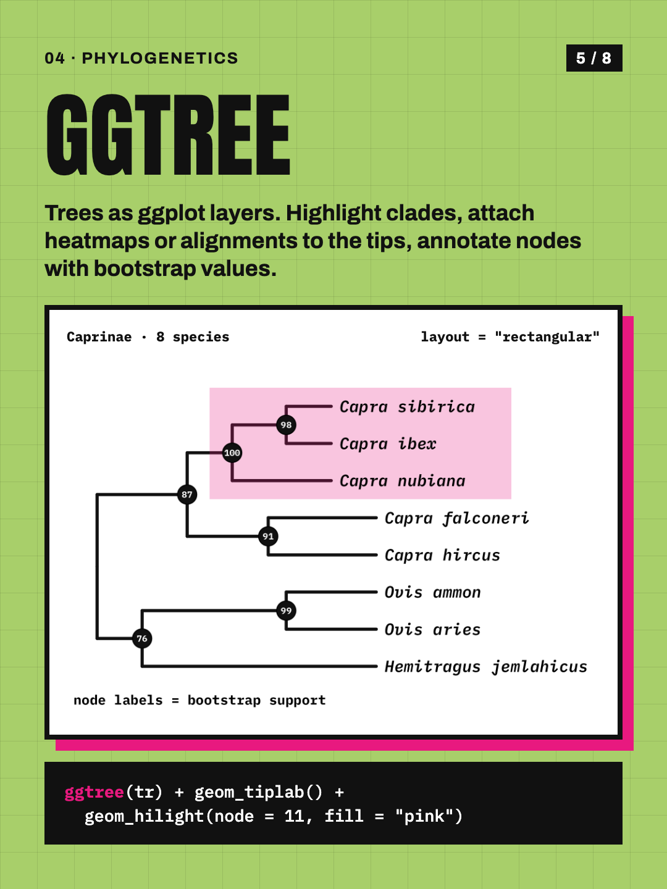

# Bioinformatics plots in R

The code behind the Ibex Instagram carousel **"Bioinformatics plots in R"**: six packages that turn tables of genes into figures.
Every plot in the carousel is real R output from the scripts in [`R/`](R).

<p align="center">
  
  
  
  
</p>

| # | Package | Plot | Script | Data |
|---|---|---|---|---|
| 01 | [ggvolc](https://github.com/loukesio/ggvolc) | volcano plot | [`R/01_volcano.R`](R/01_volcano.R) | `ggvolc::all_genes`, 4,857 yeast genes from DESeq2 |
| 02 | [ggsynteny](https://github.com/loukesio/ggsynteny) | circular synteny + annotation rings | [`R/02b_synteny_circular.R`](R/02b_synteny_circular.R) (linear: [`R/02_synteny.R`](R/02_synteny.R)) | `ggsynteny::rice_sorghum`, 100 blocks; rings = genes per 2 Mb and block score, both from the block table |
| 03 | [ggraph](https://ggraph.data-imaginist.com) | network | [`R/03_network.R`](R/03_network.R) | simulated scale-free graph, 40 nodes |
| 04 | [ggtree](https://yulab-smu.top/treedata-book/) | annotated phylogeny | [`R/04_tree.R`](R/04_tree.R) | Caprinae, 8 species (illustrative topology and support values) |
| 05 | [ggiraph](https://davidgohel.github.io/ggiraph/) | interactive PCA | [`R/05_pca.R`](R/05_pca.R) | simulated expression, 24 samples, real `prcomp` |
| 06 | [patchwork](https://patchwork.data-imaginist.com) | Figure 1 | [`R/06_patchwork.R`](R/06_patchwork.R) | the plots above |

Hover the PCA yourself: open [`plots/pca_interactive.html`](plots/pca_interactive.html) in a browser.

## Run it

```r
install.packages(c("ggvolc", "ggraph", "tidygraph", "igraph", "ape", "ggiraph", "patchwork", "ragg"))
BiocManager::install("ggtree")
remotes::install_github("loukesio/ggsynteny")   # >= 0.5.0 for the circular layout
```

Install the [IBM Plex Mono](https://fonts.google.com/specimen/IBM+Plex+Mono) font, then from this folder:

```bash
Rscript R/render_all.R     # writes plots/*.png
```

All plots share one theme, [`R/theme_ibex.R`](R/theme_ibex.R): IBM Plex Mono, black axes, no grid, one accent colour.

## The slides

[`slides/`](slides) holds the eight 1080×1440 (3:4) images as posted. The slide layout is a static HTML page rendered with headless Chrome.
