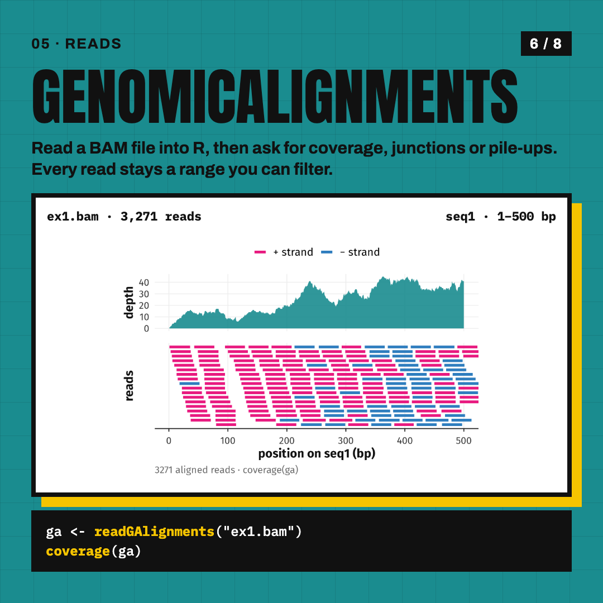

# Sequence analysis in R

The code behind the Ibex Instagram carousel **"Sequence analysis in R"**: six packages that take you from a FASTA file to a genome-browser view.
Every plot is real R output from data that ships with the packages, so the scripts in [`R/`](R) run offline.

<p align="center">
  
  
  
  
</p>

| # | Package | What the slide shows | Script | Data |
|---|---|---|---|---|
| 01 | [Biostrings](https://bioconductor.org/packages/Biostrings) | GC content in a 100 bp sliding window | [`R/01_biostrings.R`](R/01_biostrings.R) | yeast ORF EFB1 from `someORF.fa` (Biostrings) |
| 02 | [blastar](https://github.com/loukesio/blastar) | Smith–Waterman identity profile, human vs mouse | [`R/03_blastar.R`](R/03_blastar.R) | PAH mRNAs from `exampleDNA.fasta` (msa) |
| 03 | [msa](https://bioconductor.org/packages/msa) | ClustalW alignment as a tile map | [`R/02_msa.R`](R/02_msa.R) | 17 alpha-globins from `HemoglobinAA.fasta` (msa) |
| 04 | [GenomicRanges](https://bioconductor.org/packages/GenomicRanges) | `findOverlaps` between CpG islands and genes | [`R/04_granges.R`](R/04_granges.R) | chr7 demo data (Gviz) |
| 05 | [GenomicAlignments](https://bioconductor.org/packages/GenomicAlignments) | coverage and stacked reads from a BAM | [`R/05_alignments.R`](R/05_alignments.R) | `ex1.bam` (Rsamtools) |
| 06 | [Gviz](https://bioconductor.org/packages/Gviz) | axis, gene and CpG tracks with a highlight | [`R/06_gviz.R`](R/06_gviz.R) | chr7 demo data (Gviz) |

## Run it

```r
BiocManager::install(c("Biostrings", "msa", "GenomicRanges", "GenomicAlignments", "Rsamtools", "Gviz"))
remotes::install_github("loukesio/blastar")
install.packages(c("ggplot2", "ggrepel", "patchwork", "dplyr", "tidyr", "ragg"))
```

Install the [Fira Sans](https://fonts.google.com/specimen/Fira+Sans) font, then from this folder:

```bash
Rscript R/render_all.R     # writes plots/*.png
```

All ggplot figures share [`R/theme_seq.R`](R/theme_seq.R): a light minimal theme, Fira Sans, one accent colour per plot.
Gviz and GenomicRanges must come from the same Bioconductor release (3.22 at the time of writing).

## The slides

[`slides/`](slides) holds the eight 1080×1080 images as posted.
